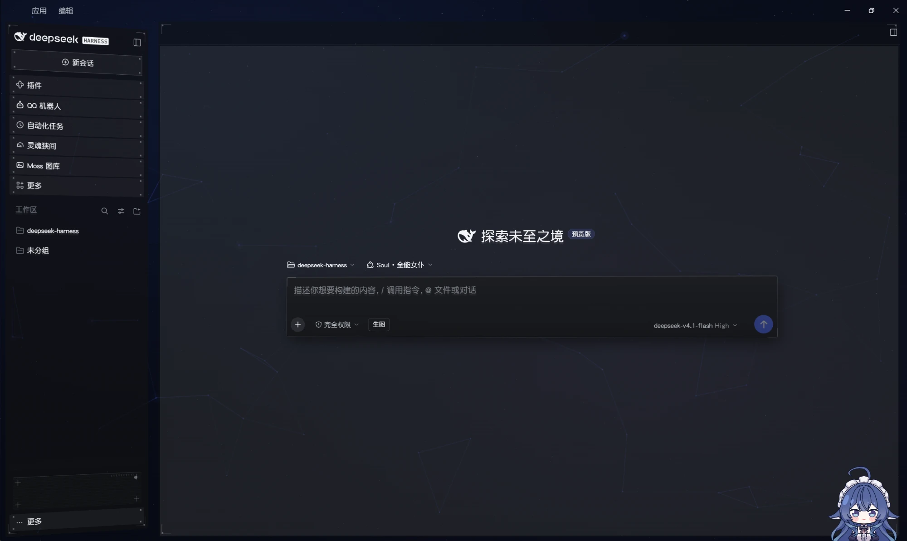

# 全鲸封锁（dsh-blockade-skin-alter）

DeepSeek Harness 网页界面的封锁风 HUD 皮肤，从「封锁橙 dsh 皮肤插件」2.3.2 改来，和灵魂狭间（dsh-chara-soul）用同一套风格。

界面部分只覆盖主题变量、注入一张样式表，不改宿主代码，卸载后恢复原样；宿主部分只做一件事：按 token 用量算花了多少钱，给侧栏读数面板看。要停用皮肤，在插件管理里关掉本插件。



> 同人作品，非官方。与 Ubisoft、Massive Entertainment 无关。「Tom Clancy's The Division」是其所有者的商标。

## 安装

1. 到 [Releases](https://github.com/Akashyc/dsh-blockade-skin-alter/releases) 下载最新版的 `dsh-blockade-skin-alter.tgz` 或 Source code（zip），解压到任意目录（路径可以带空格）。也可以直接 `git clone` 本仓库。
2. 在 DeepSeek Harness 里执行：

   ```text
   plugin_manager install_bundle "/解压后的路径/dsh-blockade-skin-alter"
   ```

3. 完全退出客户端再打开：macOS 按 Cmd+Q；Windows 关窗口后确认托盘图标也退出了。只按 Cmd+R / Ctrl+R 刷新页面，客户端模块可能还是旧的缓存。

装了原版「封锁橙」的，建议先卸载它，两张皮肤叠着用没意义。

**更新**：下载新版解压，覆盖原来的目录，再完全退出客户端重开。

**卸载**：

```text
plugin_manager remove_bundle @local/dsh-blockade-skin-alter
```

设置存在浏览器 localStorage 里，卸载后不会自动删除，要清干净可以在开发者工具里删掉。

## 和封锁橙相比改了什么

- **主题色可调**：7 个预设（深海蓝、封锁橙、信号青、星云紫、樱粉、皇冠金、极光绿）加自制色盘（饱和度/明度方块、色相条、HEX、R/G/B），默认深海蓝 `#4C6AFC`。原来写死的橙色全部跟着主题色走；底色上的小字、主按钮上的字由主题色自动推算，保证看得清。
- **背景**：等高线地图和扫光换成深空渐变 + 3D 星空 + 神经连线（WebGL），连线跟着主题色。星点和节点有前后层次，近大远小，鼠标移动有轻微视差；平时以 30 帧缓慢运动，镜头慢慢漂移。拿不到 WebGL 时退回 2D 画法。窗口在后台、开了轻量模式或系统要求减少动态效果时停住。
- **主题色联动**：和灵魂狭间都装时，灵魂狭间的外观交给本皮肤，主题色、背景都以这里为准；只装一个时各管各的。
- **字体**：不内置字体，跟随 DSH 设置（见下面「字体」）。
- **侧栏显示花费**：读数面板最上面两行是「本轮」和「会话」的金额，按每一步的 token 用量和 DeepSeek 官方价（分峰谷、周末和法定节假日按空闲价）现算，跟着你正在看的会话走，「本轮」旁边的小字「峰 / 谷」表示现在按高峰价还是空闲价。金额从 DSH 自己的会话记录里统计（先问 DSH 的会话查询服务，没有再读日志文件），10 秒没有新动静就重新统计一遍，重启 DSH 也不清零；分身的花费不算进主会话。不在会话页时，金额和其他读数一起隐藏。轮、步、速度、用量压成两行，每行左右各一格。走别的渠道或用别的模型时，到设置里填自定义价目表。面板上的「详细 ▾」展开当前会话的用时（模型、工具、首字平均、输出速度）和用量（花费、缓存命中、输入、缓存读写、输出），以及 DeepSeek 官方账户余额（总额、赠送、充值；先用 DSH 里保存的 DeepSeek API 密钥查，没有密钥或查不到时改用 DSH 里登录的 DeepSeek 账号查）。官方价和峰谷、节假日由仓库每天自动抓一次（GitHub Actions），装好的插件每天从 jsDelivr 取一次最新价目，取不到就用手上的那份；设置里也可以手动刷新。
- **设置更简洁**：去掉了总开关（用插件开关代替），去掉了读数面板的几何项（列数、宽度、对齐、偏移、圆角、切角、倾斜、层级、上移账号行）——读数面板早已改成嵌在侧栏里，这些项在原版里就不再生效。
- **设置弹窗不透底**：原版弹窗底色只有 22% 不透明，后面的内容会透上来，改为 90%。浅色主题下换成浅色磨砂、用深色字，宿主的白底控件也看得清。
- **插件市场可读**：dshmarket 的吸顶栏和「任务」弹窗加了实底，滚动时不再和卡片叠字。
- **顶部不割裂**：Windows 标题栏和会话标题条去掉自带底色，只留细线，星空背景一直透到顶。
- 模块名、存储键、事件名都改了，和原版封锁橙同时装也不会互相干扰（但两张皮肤叠着用没意义）。

## 设置

设置 → 全鲸封锁：

| 项 | 作用 |
|---|---|
| 主题色 | 预设、色盘、恢复默认色；点「自定义」直接选中 HEX 输入框。改了立即生效 |
| 星空背景 | 深空底色上的星点，少数会闪烁 |
| 神经连线 | 缓慢漂移的节点与连线，颜色跟主题色 |
| 节点脉动 | 亮节点缓慢呼吸；默认关，要「神经连线」开着才看得见 |
| 自定义背景 | 任意 CSS 图片值或本地图片，代替深空渐变，星点和连线照样叠在上面；本地图片建议 3 MB 以内，太大存不进本地设置时会弹窗提示 |
| 轻量模式 | 去掉模糊和动效，给性能弱的机器 |
| 花费 · 自定义价目表 | 每行一个模型：`模型 \| 缓存命中 \| 输入 \| 输出`（元 / 百万 token），空着的沿用官方价，自定义价不分峰谷。改完马上按新价重算，以前的会话也一样。走火山方舟等渠道、或用非 DeepSeek 模型时填 |
| 花费 · 官方价 | 「刷新」马上取一次最新价目（平时每天自动取一次），旁边显示现在用的是哪天的官方价 |

在开发者工具的控制台里也能改：

```js
__blockadeAlter.hud.get()
__blockadeAlter.hud.set({ accent: '#2EC4B6' })
__blockadeAlter.hud.reset()
```

## 字体

本包不带字体文件，界面用 DSH 设置里的正文字体。想要和截图一样的效果，推荐：

- 英文与数字：**Borda**（The Northern Block，商用字体，需自行取得授权）
- 中文：**华康圆体 W5**

装好字体后，到 DSH 设置 → 通用设置 → 字号大小 → 展开「更多字体设置」→ 正文字体，填：

```text
"Borda", "华康圆体W5(P)"
```

改完按回车或点别处才会提交，立即生效。字体名以系统里注册的为准（Windows 在「设置 → 个性化 → 字体」里能看到）；名字不对时会退回 DSH 默认字体。灵魂狭间的侧栏面板也跟着这里的字体走。

## 主题色联动的约定

给想接入的插件看。都在宿主窗口上：

- `window.__dshAccent`：当前主题色，`#RRGGBB`
- `dsh-accent` 事件，`detail` 为 `{ accent, source }`：谁改了色就发一次，`source` 写自己的名字；收到别人发的就跟着改，自己不再转发

灵魂狭间的侧栏面板（iframe）由它的 `adapter-dsh/client.js` 把宿主上的主题色推进 iframe；面板收到后隐藏自己的外观设置、不画自己的背景，直接透出本皮肤的。

## 参考

| 来源 | 借什么 |
|---|---|
| 「封锁橙 / Blockade Orange」dsh 皮肤插件 2.3.2，作者 之一ONETHING（[B 站介绍视频](https://www.bilibili.com/video/BV1CXxY6KEtS/)） | 本包的底子：半透明悬浮面板、HUD 读数、四角刻标、菜单悬浮反馈等整套样式与代码。MIT 许可，原版权声明保留在 `LICENSE` |
| [Nwflower/dsh-claude-style](https://github.com/Nwflower/dsh-claude-style) | 自定义价目表的思路：按模型覆盖、空格子沿用默认价，价目随请求带给宿主，宿主读会话日志现算 |
| [MeteorNOX/DeepSeek-Balance-Whale-Widget](https://github.com/MeteorNOX/DeepSeek-Balance-Whale-Widget) | 侧栏金额的计价表和峰谷、节假日规则（`index.js`）；余额的取法（DSH 凭据服务里的 `DEEPSEEK_API_KEY` + 官方 `/user/balance`，查不到时用 DSH 账号服务 `deepseekAccount.getBalance`），MIT 许可 |
| [TangMuLiEath/dsh-neural-startup](https://github.com/TangMuLiEath/dsh-neural-startup) | 深空神经核心的视觉意象，背景的星空与神经连线由此而来（自己用 WebGL / canvas 重写，没有拷贝代码） |

## 署名与商业使用

代码走 **MIT**：保留 `LICENSE` 的版权声明和许可声明（原作「封锁橙」作者的与本包的两条都要留）即可商用、修改、再发布。

商业使用、二次发行、衍生产品，请在关于页、README 或发行说明中尽量注明：

> 全鲸封锁 / dsh-blockade-skin-alter by Yuu，改自「封锁橙 / Blockade Orange」by 之一ONETHING

这是一条**署名请求**，不是 MIT 之外的附加许可条件。「全鲸封锁」的名称不随 MIT 代码许可一并授予，不要用它暗示官方背书；「The Division」相关商标属于其所有者，见上方声明。

## 隐私

不加载外部字体或图片、不收集任何数据。联网只有两处，都在宿主部分：每天取一次价目文件（`cdn.jsdelivr.net`，取不到再试 `raw.githubusercontent.com`），只下载，存到 `~/.dsh/cache/dsh-blockade-skin-alter/prices.json`；展开「详细」时最多每分钟查一次官方余额（`api.deepseek.com/user/balance`），密钥通过 DSH 的凭据服务取，只放在发给 DeepSeek 的请求头里，不写文件、不交给页面；用登录账号查时走 DSH 自己的账号服务。金额在本机算：只读 DSH 自己的会话记录（`~/.dsh/sessions`）里的用量，通过 DSH 的本地服务给侧栏读，经过 DSH 的访问校验，不发到任何地方。设置（主题色、背景开关、自定义背景）只存在本机浏览器的 localStorage 里，卸载后可手动清除。自定义背景填网络图片地址时，加载那张图会访问对应的网站，这由你自己决定。

这不是法律意见；企业使用请先过内部合规/安全评审。
